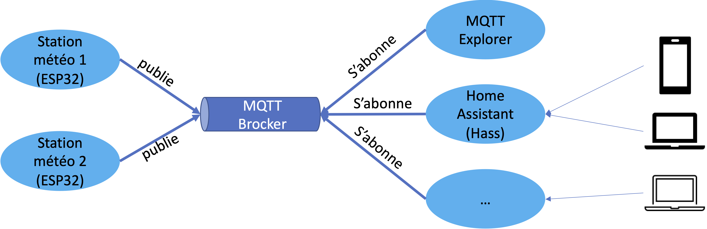

# TP03 - Station météo

**Les consignes sont sujettes à modification. Reportez-vous à ce qui est communiqué durant le cours.**

## 1 - Directives

### 1.1 - Déroulement du TP

- La remise du travail doit être effectuée pour le dimanche 29 novembre 2026 23:59 maximum (Présenté le vendredi 27 novembre 2026 en AM, mais remis officiellement le dimanche 29 novembre 2026 avant minuit)
- Le projet est réalisé en équipe de 2 personnes
- Vidéo de 5 minutes illustrant le fonctionnement
- Vidéo promotionnelle de maximum 1 min de votre produit
- Les vidéos doivent être déposées sur Youtube avec une option de partage « non listée »
- Vous devez utiliser Git pour gérer vos sources
- Vous devez utiliser SharePoint pour gérer votre document de rapport (Onglet "Fichiers" de votre équipe Teams)
- La structure de votre répertoire racine doit suivre la structure donnée dans le dépôt Git
- Le code source doit être dans le répertoire « src » et suivre la structure d’un projet Platform.io
- Vous devez modifier un fichier README.md contenant :
  - Le prénom, nom et numéro de matricule de chaque personne
  - Le lien de la vidéo sur Youtube
- Documentation détaillée du produit (manuel d’utilisation & documentation technique)
- La remise du travail doit être effectuée sur et à la date indiquée sur la plateforme d'enseignement

### 1.2 - À remettre sur la plateforme d'enseignement Léa

- Un document word contenant le détail du projet
- Votre code source
- Les liens YouTube de vos vidéos de présentation

### 1.3 - Structure de la remise

- Vous devez remplir le fichier "AUTHORS.md".
  Il donne le nom et matricule des équipiers
- Votre code source doit être dans le répertoire  ```src``` du présent dépôt Git
- Le répertoire source doit suivre la structure d’un projet Platform.io
- Vous devez fournir une vidéo de 5 minutes illustrant le circuit, le code et le fonctionnement
- Vous devez aussi fournir une vidéo promotionnelle de votre projet de maximum 1 min
- Pour les vidéos :
  - Elles doivent être déposées sur Youtube avec une option de partage « non listée »
  - Leurs liens doivent être indiqués dans le document word et dans le fichier "AUTHORS.md"
- Le répertoire "documents" doit contenir votre rapport de TP

### 1.4 - Évaluation

L'évaluation du travail est effectuée par les enseignants de l'UE en se basant sur :

- L'historique de Git et de Teams/Sharepoint font office de référence pour évaluer la proportion du travail effectué par chaque équipier

- La qualité et le contenu du code source :

  - Conformité du code et des normes d'écriture utilisées dans le cours
  - Fonctionnalité du code
  - Facilité de lecture du code
  - Modularité
  - Modèle objet
  - Paramétrisation du code
  - Utilisation de constantes
  - Utilisation de fichiers de configuration
  - etc.

- La qualité et le contenu du document word :
  
  - Français
  - Schéma
  - Clarté et précision des explications
  - Mise en page
  - Page de présentation
  - etc.

- La qualité et le contenu de la présentation vidéo :

  - Vidéo
  - Audio
  - Explication orale
  - etc.

- Contribution individuelle : l'historique Git et de Teams/SharePoint, le registre des tâches et des heures ainsi que les explications de chaque personne servent à évaluer sa contribution. Le nombre de lignes de code ou le pourcentage calculé par GitInspector ne constituent pas un seuil de participation. Chaque personne doit comprendre le fonctionnement d'ensemble et pouvoir expliquer ses contributions et les choix techniques du projet, y compris le code développé avec un agent IA.

L'utilisation déclarée d'un agent IA dans le cadre décrit ci-dessous est autorisée. Cette autorisation ne permet pas le partage de travaux entre équipes sans autorisation ni la présentation de contenu provenant d'autres sources sans les référencer.

Le code donné dans le cours n'est pas à référencer.

### 1.5 - Utilisation des agents IA

Vous pouvez utiliser un/des agent(s) IA pour développer un produit plus ambitieux pendant les quatre semaines du projet. Si vous choisissez l'IA pour le développement, utilisez le **mode agent dans votre environnement de développement**, connecté à votre dépôt et capable de consulter les fichiers, de les modifier et de lancer les vérifications autorisées. Une conversation dans une interface web avec copier-coller de code ne constitue pas la démarche attendue.

- Définissez les besoins et les contraintes avant de demander du code. Faites proposer un plan pour les changements importants, puis avancez par petites étapes vérifiables.
- Relisez les modifications et conservez une architecture claire et proportionnée au besoin. La quantité de code ne donne pas de points : évitez les dépendances, abstractions et fonctionnalités inutiles. "La perfection est atteinte non pas lorsqu'il n'y a plus rien à ajouter, mais lorsqu'il n'y a plus rien à retirer." (Antoine de Saint-Exupéry)
- Vous restez responsables de comprendre et de vérifier le code livré. Distinguez la compilation et les tests sur ordinateur des essais réellement effectués sur le montage.
- Conservez dans le dépôt un environnement de travail avec l'agent (« harness ») : consignes adaptées au projet, commande de compilation et moyens de vérification. Il n'est pas demandé de développer votre propre agent.
- Déclarez les outils utilisés et leur rôle, puis analysez trois décisions significatives : proposition envisagée, choix de l'équipe, justification et vérification du résultat. Il n'est pas demandé de remettre toutes les conversations.
- Le fichier AGENTS.md doit être disponible dans le dépôt et contenir les consignes et moyens de travail avec l'agent, ainsi que les traces pertinentes des décisions significatives.
- Ne fournissez pas de mots de passe réels, de clés d'accès ou de données personnelles à l'agent et ne les ajoutez pas au dépôt.

L'usage de l'IA reste facultatif et aucun abonnement payant n'est exigé. Les équipes sans IA expliquent également leur démarche, leurs décisions et leurs apprentissages.

Un [guide de démarrage avec un agent IA](./propositions/Introduction-agents-IA.md) propose une méthode de travail, des exemples de demandes et un atelier d'introduction.

## 2 - Description du projet

Le regroupement « les hackers de Québec » désire créer un modèle de station météo facile à concevoir, accessible à tous et à utiliser.

Le socle technique commun à tous les projets comprend :

- L'intégration avec [Home Assistant](https://www.home-assistant.io) par MQTT
- La découverte automatique des entités dans Home Assistant (**autodiscovery**), sans création manuelle des entités de mesure
- La transmission de la température et de la pression atmosphérique
- La transmission de l'humidité lorsque le capteur la fournit : attendue avec un BME280, non exigée avec un BMP280

L'utilisation d'un BMP280 n'entraîne aucune pénalité ni réduction de la note maximale accessible au produit. Indiquez le capteur utilisé et les mesures disponibles; ne transmettez pas de valeur d'humidité fictive.

**Durant la conception de votre station météo, vous avez eu votre "Eurêka" ! Vous avez un meilleur projet à développer qu'une simple station météo et vous décidez de le mettre en œuvre au travers d'un prototype fonctionnel proche du produit final. Ce produit sera présenté aux pré-sélections des Dragons afin d'obtenir un financement.**

La station météo sert de mise en contexte. Vous devez développer un produit « vendable », destiné à une clientèle précise, qui répond à un problème concret et donne envie d'investir. Le socle technique doit être intégré à votre produit final.

**Un projet limité au socle technique commun est plafonné à 60 % pour l'ensemble du TP.** La note est calculée avec la grille, puis limitée à 60/100 si le projet reste à ce niveau; ce n'est pas une note acquise. Pour dépasser ce plafond, démontrez un scénario d'utilisation propre à votre produit qui rend un service au-delà de la consultation des mesures, et expliquez pourquoi votre clientèle le choisirait. Un nom commercial, un boîtier ou une publicité ne suffisent pas à eux seuls. Faites valider le périmètre du produit lors de la préparation du projet.

Pour ce projet, vous devez utiliser le matériel et technologies suivantes :

- ESP32
- Wifi
- BME280 ou BMP280
- MQTT
- Home Assistant avec autodiscovery
- WifiManager (pour la configuration du Wi-Fi et les variables de configuration pour MQTT minimalement)
- Git (Github) : utilisez la lien vers le travail sur classroom50 disponible sur la plateforme d'enseignement Léa pour le dépôt de votre code source



## 3 - Description détaillée du document à remettre

Le document word doit décrire le contexte du projet, sa clientèle et sa proposition de valeur, sa planification, la répartition des tâches avec un registre des heures passées, les schémas du montage, les diagrammes UML pertinents ainsi que l'inventaire des composants et une estimation des coûts.

La structure du document comprend :

- Préparation du projet : (8%)
  - Contexte du projet, clientèle, problème à résoudre et proposition de valeur
  - Scénario d'utilisation à démontrer et périmètre réalisable en quatre semaines
  - Planification, attribution des tâches
  - Inventaire des pièces : estimation des coûts des pièces
  - Estimation énergétique : durée de vie des batteries / consommation si sur secteur
  - Schéma technique avec explications

- Démarche de développement et apprentissages, avec ou sans IA (5%)
  - Outils utilisés et leur rôle; apport de l'IA si elle est utilisée
  - Analyse de trois décisions significatives, appuyée par des traces pertinentes (extraits, modifications ou commits)
  - Difficultés rencontrées, limites et apprentissages concrets

- Registre des heures consacrées au projet (2%)
  - Répartition des tâches et temps réellement consacré par chaque personne
  - La conception, la relecture et les essais comptent comme du travail; le temps de génération autonome d'un agent ne compte pas comme du temps de travail humain

- Vidéo de 5 minutes illustrant le fonctionnement (10%)
  - Présentation rapide du circuit
  - Présentation rapide de la structure du code et des choix de conception
  - Présentation du fonctionnement dans un scénario client complet, incluant les fonctions qui distinguent votre produit du socle technique
  - Démonstration d'au moins un cas de panne et de reprise

- Vidéo promotionnelle de maximum 1 minute (10%)
  - Clientèle visée, problème et bénéfice du produit
  - Capacité à donner envie d'acheter, avec des promesses fidèles au produit réalisé
  - Qualité de la communication et de la présentation

- Qualité du code et de l'architecture (20%)
  - Bon fonctionnement du programme
  - Respect des bonnes pratiques
  - Modularité et utilisation adéquate de la POO
  - Architecture claire, simplicité et absence de code inutile ou dupliqué
  - Gestion des erreurs et des pertes de connexion
  - Optimisation de la mémoire

- Produit d’une qualité de type production (hors montage qui est un prototype) (20%)
  - Manuel d’utilisation
  - Facilité de configuration
  - Présentation physique soignée et cohérente avec le produit et sa clientèle (dans la limite du matériel disponible et raisonnable pour un prototype)
  - Documentation technique et procédure de compilation reproductible
  - Si IA : consignes et moyens de travail avec l'agent (« harness ») adaptés au projet
  - Procédure et résultats des vérifications : mesures reçues dans Home Assistant, autodiscovery, pertes et retours du Wi-Fi et de MQTT, capteur absent ou lecture invalide, scénario propre au produit
  - Les équipes sans IA fournissent également les moyens de compilation et de vérification
  - Consommation électrique
  - Autonomie de la batterie

- Créativité (15%)
  - Fonctionnement des ajouts
  - Originalité des ajouts
  - Utilité des ajouts
  - Différenciation et cohérence du produit au service d'un besoin client

- Présentation orale aux Dragons (10%)
  - But du produit, clientèle et proposition de valeur
  - Prévisions économiques : coût unitaire, prix de vente, marge et hypothèses de volume et de dépenses
  - Financement demandé, utilisation prévue et prochaine étape du développement
  - Capacité à donner envie d'investir, à défendre les choix et à répondre aux questions; chaque personne doit pouvoir expliquer les choix fonctionnelles, techniques et entrepreneuriaux

**Total : 100 %.** La vidéo promotionnelle s'adresse aux clients pour donner envie d'acheter; la présentation aux Dragons s'adresse aux investisseurs pour donner envie de financer le produit. Les estimations économiques et énergétiques doivent être accompagnées de leurs hypothèses et distinguées des résultats mesurés. Il est généralement apprécié de diffuser la publicité durant la présentation aux Dragons.

Les dragons sont des investisseurs fictifs, composés de vos enseignants et de personnes invitées.

Trois équipes seront sélectionnées et gagneront un trophée pour le meilleur produit/présentation/pitch. Ces équipes sont déterminées par un vote des dragons et des étudiants. La note finale est indépendante de ce vote.

Le code doit être fourni sous la forme d’un projet « Platform.IO » bien structuré.

## 4 - Idées d'extensions

Que vous utilisiez un agent IA ou non, vous devez ajouter des fonctions à votre produit pour le rendre plus utile et plus attrayant. L'extension du socle technique commun doit être cohérente avec le scénario client et la proposition de valeur. Les ajouts doivent être démontrables dans la vidéo de 5 minutes et dans la présentation aux Dragons.

L'utilisation d'un agent IA peut vous aider à réaliser des intégrations plus ambitieuses pendant les quatre semaines du projet.

### 4.1 - Intégrations possibles

- **Voix et audio** : microphone, commande vocale, haut-parleur, réponse parlée, annonce d'un événement ou interaction avec un assistant vocal comme [Assist de Home Assistant](https://www.home-assistant.io/voice_control/) (HAL 9000 m'achète un peu).
- **Interface utilisateur** : écran LCD, OLED ou tactile, menus, boutons, encodeur rotatif, voyants ou retour sonore pour configurer et utiliser le produit sans ouvrir Home Assistant.
- **Actionneurs** : relais, servomoteur, ventilateur, pompe, brumisateur, Peltier (Chaud / Froid)  ou éclairage pour agir sur l'environnement, avec commande manuelle et retour d'état. Les montages de démonstration utilisent des charges basse tension adaptées au matériel.
- **Signalisation et éclairage** : ruban, anneau ou matrice de DEL adressables pour afficher un état, guider l'utilisateur, signaler une progression ou personnaliser l'ambiance du produit.
- **Caméra et vision** : ESP32-CAM ou autre caméra, capture d'images, détection d'objets ou de personnes avec [Frigate](https://docs.frigate.video/), et reconnaissance de visages avec [Frigate](https://docs.frigate.video/configuration/face_recognition/) ou un autre service compatible.
- **Identification et personnalisation** : badge NFC/RFID ou code QR pour sélectionner un profil, déclarer une action ou associer un équipement à un utilisateur.
- **Présence et état des lieux** : détection de mouvement ou de présence, contact d'ouverture, capteur de distance, détection de fuite ou mesure de luminosité pour adapter le comportement du produit.
- **Services et suivi** : notifications avec acquittement, historique d'événements, tableau de bord, interface web de configuration, calendrier ou intégration à une API utile au produit.
- **Autonomie et maintenance** : fonctionnement hors connexion, synchronisation au retour du réseau, diagnostic, estimation de batterie ou mise à jour à distance documentée.

Vous pouvez répartir les fonctions entre l'ESP32, Home Assistant et des services sur un ordinateur ou un serveur. Indiquez dans votre architecture où s'effectuent l'acquisition, le traitement et la décision. Pour la voix et la vision, validez tôt la compatibilité du matériel, les formats échangés et les ressources nécessaires. Par exemple, certains flux de caméra MJPEG nécessitent un réencodage pour l'enregistrement dans Frigate : consultez sa [documentation de configuration des caméras](https://docs.frigate.video/configuration/camera_specific/).

### 4.2 - Quelques références de matériel à rechercher

Ces exemples servent de points de départ pour vos recherches, selon les besoins du produit et le matériel disponible. Vérifiez la fiche du module exact, sa bibliothèque, son alimentation et ses niveaux logiques avant de le choisir. Les liens donnent accès à des exemples ou à de la documentation; aucun achat particulier n'est imposé.

| Fonction | Noms ou références à rechercher | Usage et points à vérifier |
| --- | --- | --- |
| Température d'un liquide | **DS18B20 en sonde étanche**, interface 1-Wire ([exemple](https://www.adafruit.com/product/381)) | Mesure dans un réservoir ou un circuit de liquide; choisir une sonde et une gaine adaptées au liquide et à la température prévue. |
| Pression d'un liquide | **DFRobot Gravity SEN0257** ([fiche](https://wiki.dfrobot.com/sen0257/)) | Suivi de la pression d'un circuit d'eau; vérifier la plage, les raccords et la compatibilité avec le fluide. Ce modèle est alimenté en 5 V et sa sortie analogique peut atteindre 4,5 V : prévoir une adaptation à l'entrée de l'ESP32. |
| Rayonnement UV | **LTR390**, module I2C ([exemple](https://www.adafruit.com/product/4831)) | Suivi des variations d'exposition aux UV; distinguer la mesure du capteur d'un indice UV calculé et validé. |
| Vitesse du vent | **Anémomètre à coupelles avec sortie à impulsions**, par exemple celui du [SparkFun Weather Meter Kit](https://www.sparkfun.com/weather-meter-kit.html) | Mesure de vitesse à partir des impulsions; utiliser la relation d'étalonnage fournie pour le modèle choisi. |
| Affichage de texte | **LCD1602** ou **LCD2004**, avec adaptateur I2C **PCF8574** ([exemple LCD1602](https://docs.sunfounder.com/projects/sf-components/en/latest/component_i2c_lcd.html)) | Menus et informations sur 16 × 2 ou 20 × 4 caractères; vérifier la tension du module et des résistances de rappel du bus I2C. |
| Petit affichage graphique | **OLED SSD1306**, souvent en 128 × 64 pixels ([références Espressif](https://github.com/espressif/esp-bsp/blob/master/docu/LCD.md)) | Icônes, menus, courbes simples ou état du produit; vérifier la résolution et l'interface du module. |
| Affichage couleur | **TFT ST7789** ou **ILI9341** ([références Espressif](https://github.com/espressif/esp-bsp/blob/master/docu/LCD.md)) | Interface graphique et tableaux de bord; la fonction tactile dépend du module et de son contrôleur tactile. |
| Commande marche/arrêt | **Module relais 1, 2 ou 4 voies**, avec entrée de commande compatible 3,3 V | Commande d'une charge basse tension; distinguer l'alimentation du module, sa commande et la puissance admise par ses contacts. |
| Positionnement mécanique | **Servomoteur SG90** ([fiche fabricant](https://towerpro.com.tw/product/sg90-7/)) ou **MG90S** ([fiche fabricant](https://towerpro.com.tw/product/mg90s-3/)) | Ouvrir une trappe, orienter une caméra ou régler un volet; vérifier le couple nécessaire, la course, la tension et le courant d'alimentation du modèle choisi. |
| Chauffage ou refroidissement | **Module Peltier TEC1-12706** ([exemple de fiches fabricant](https://www.weisourcing.com/everredtronics/downloads/)) ou [ensemble Peltier avec dissipateur](https://www.adafruit.com/product/1335) | Régulation thermique; prévoir un dissipateur sur la face chaude, une alimentation et un circuit de puissance adaptés. |
| Ventilation | **Ventilateur 5 V ou 12 V**, éventuellement **4 fils PWM avec retour de vitesse** ([guide fabricant](https://www.noctua.at/en/support/faqs/microcontroller-guide-pwm-setup-and-rpm-monitoring)) | Ventilation pilotée, ajustement de vitesse et suivi de rotation selon le modèle; vérifier les tensions et l'interface de commande. |
| Badges NFC/RFID | **RFID readers** [Exemple RFID](https://projecthub.arduino.cc/coolcat231/simple-rfid-tutorial-d6f10e), avec badges compatibles | Identification, profil utilisateur ou suivi d'emprunts; vérifier les types de badges pris en charge par le lecteur. |
| DEL adressables | **WS2812B / NeoPixel**, **SK6812**, notamment en version RGBW ([guide NeoPixel](https://learn.adafruit.com/adafruit-neopixel-uberguide)); **APA102 / DotStar** ([guide DotStar](https://learn.adafruit.com/adafruit-dotstar-leds)) | Rubans, anneaux ou matrices contrôlés pixel par pixel. Les variantes NeoPixel utilisent une ligne de données; les APA102 utilisent des lignes de données et d'horloge. Prévoir l'alimentation et l'adaptation de niveau nécessaires. |

Les moteurs, servomoteurs, pompes, ventilateurs, modules Peltier et rubans de DEL sont alimentés par une source dimensionnée pour leur consommation, avec un circuit de commande approprié. Les GPIO de l'ESP32 servent à la commande. Pour les rubans, estimez la consommation selon le nombre de DEL et la luminosité prévue; le [guide d'alimentation NeoPixel](https://learn.adafruit.com/adafruit-neopixel-uberguide/powering-neopixels) donne des exemples de dimensionnement.

### 4.3 - Exemples de produits à imaginer

| Piste de produit | Clientèle et service rendu | Intégrations possibles |
| --- | --- | --- |
| Console domotique accessible | Permettre à une personne de piloter ses équipements avec une interaction adaptée à ses besoins. | Voix, gros boutons, écran lisible, confirmation sonore et commandes MQTT. |
| Accueil personnalisé pour un atelier ou un club | Identifier un membre volontaire, afficher ses informations utiles et signaler l'arrivée d'un visiteur. | Caméra, reconnaissance de visage ou badge, écran, message vocal et notification. |
| Gestion d'un local partagé | Indiquer l'occupation, afficher une réservation et adapter un équipement aux conditions d'utilisation. | Détection de présence, calendrier, écran, capteurs et relais. |
| Suivi du prêt de matériel | Enregistrer un emprunt et un retour, rappeler un retard et afficher les équipements disponibles. | Badges ou QR, écran, boutons, historique et notifications. |
| Mini-serre pour un propriétaire absent | Configurer des objectifs, piloter l'arrosage ou la ventilation et consulter visuellement l'état des plantes. | Capteurs pertinents, pompe, relais, écran et caméra. |
| Suivi d'une zone de livraison | Signaler une arrivée, conserver une trace visuelle et permettre à l'utilisateur de confirmer la prise en charge. | Caméra, détection, notification avec acquittement et historique. |
| Protection d'un espace de stockage | Détecter une ouverture, une fuite ou des conditions inhabituelles, puis accompagner l'intervention. | Capteurs, caméra, avertisseur, éclairage et suivi des incidents. |

Ces exemples sont des pistes à adapter et à vérifier, sans garantie de note. Votre proposition doit intégrer le socle technique commun et démontrer un scénario client complet. Un ajout isolé ne garantit pas de dépasser le plafond de 60 % : c'est la valeur et l'aboutissement du produit qui comptent. Pour les démonstrations avec voix ou visages, utilisez des participants volontaires et précisez quelles données sont conservées.

L'affichage de mesures, le confort calculé, les prévisions météo ou l'enregistrement hors connexion peuvent toujours contribuer à votre produit. Reliez chaque fonction à son usage, à son coût et à un résultat que vous pourrez démontrer.

## 5 - Références

- [Module 13 - WiFiManager et MQTT](https://github.com/PiFou86/420-W48-SF/blob/main/Module13_ESP32_WiFiManager_MQTT/Module13_ESP32_WiFiManager_MQTT_Exercices.md)
- [Home assistant](https://github.com/PiFou86/420-W48-SF/blob/main/random/README.md#home-assistant)
- [Autodiscovery](https://github.com/PiFou86/420-W48-SF/blob/main/random/IntegrationMQTT/README.md)
- [Économie d’énergie](https://lastminuteengineers.com/esp32-sleep-modes-power-consumption/)
